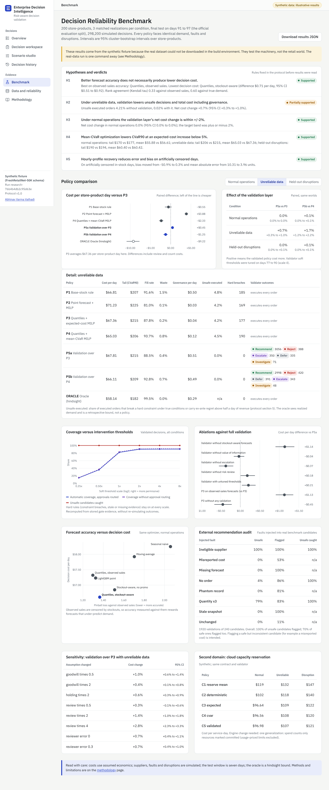
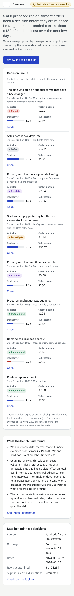
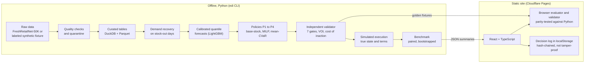

# Enterprise Decision Intelligence

Risk-aware business decision optimization and validation.

A forecast can be accurate and still lead to a bad order. Fresh food spoils, shortages cost more than leftovers, suppliers slip, and the stock record the plan relied on is sometimes wrong. This project asks a narrower question than "how good is the forecast": **when should an independent check approve, verify, wait on, escalate or block a proposed decision, and what does that check cost and save?**

It has two parts:

1. **An independent decision validation engine.** It takes a proposed decision (from this project's optimizer or any other tool), compares it with the terms of record, and returns one of five outcomes: recommend, investigate, defer, escalate or reject. Seven gates check data freshness, hard constraints, the proposer's own cost claims, downside risk, stress cases, missing evidence and governance. Hard failures are never averaged into a score. When an input looks wrong it prices a stock count with the value of verification and the expected value of perfect information, and it compares the decision with waiting a day, ordering less, escalating and doing nothing.
2. **A Decision Reliability Benchmark.** Five policies, from a base-stock rule to a mean-CVaR mixed-integer program, with and without the validator, face identical simulated worlds under normal operations, unreliable data and held-out disruptions. It scores total cost including review and stock-count costs, tail cost, fill rate, waste, constraint breaches and unsafe decisions, with paired cluster-bootstrap intervals, ablations, sensitivity analysis and a fault-injection audit.

A static web app lets a planner work through the decisions the benchmark produced, change assumptions and re-run the optimizer and validator in the browser, and read the benchmark.

> **Data status.** Every number in this repository and on the site comes from a **synthetic fixture** with the exact schema of FreshRetailNet-50K, because the dataset host was unreachable from the build environment. The fixture has generated stock-outs and known true demand, which makes leakage and recovery checks exact, but it says nothing about real stores. Suppliers, costs, disruptions and faults are simulated in every configuration. Running `scripts/download_freshretailnet.py` and the pipeline on a machine that can reach Hugging Face regenerates everything from the real data.

## What the benchmark found

Synthetic fixture, 200 store-products, three conditions, three demand realizations each, 298,200 simulated decisions. Full tables, intervals and negative results: `docs/BENCHMARK_FINDINGS.md`.

| | Normal operations | Unreliable data | Held-out disruptions |
|---|---|---|---|
| Validation (P5a vs P3), total cost incl. reviews | 0.01% lower (no clear effect) | **0.67% higher** (0.33% to 0.99%) | 0.05% higher (0.01% to 0.09%) |
| Unsafe executed orders, P3 → P5a | 0% → 0% | **4.21% → 0.02%** | 0% → 0% |
| Hard-constraint breaches, P3 → P5a | 0 → 0 | **177 → 0** | 0 → 0 |
| Mean-CVaR vs expected-cost MILP (P4 vs P3) | 1.30% cheaper | 3.46% cheaper | no clear difference |
| Observed-sales instead of stockout-aware forecasts (P3) | 1.26% more expensive | 1.68% more expensive | 0.73% more expensive |

- **The validator made decisions safer, not cheaper.** With unreliable data it caught all 174 unsafe proposals (every one caused by a stale supplier snapshot). Before review and stock-count costs, P5a and P3 cost the same; the 0.67% increase is the cost of the reviews and counts themselves.
- **The cost metric does not price a breach.** The simulator cuts a breached order back to what the supplier can deliver and charges only for the resulting shortage. Real breaches cost more (rejected orders, emergency sourcing, penalties), so the comparison above understates the validator's value by an amount this project cannot measure.
- **Better forecast accuracy did not mean cheaper decisions.** The model with the best accuracy against observed sales produced costlier orders than the stockout-aware model, which looks worse on that metric because sales on stock-out days understate demand.
- **Risk-aware optimization was the best policy** in every condition and also cut tail cost (CVaR90) by about 4% in normal operations and with unreliable data.
- **Several mechanisms did not pay off:** the soft risk gates (all unsafe proposals were caught by hard rules), escalation (removing it lowered cost), value-of-information stock counts (no measurable effect), and validation on top of the risk-aware policy (1.66% more expensive). A tuned base-stock rule matched the expected-cost MILP outside disruptions.
- **In the second domain, cloud capacity, validation lowered cost** by 2.1% with unreliable data and 1.3% under disruptions.

Hypotheses fixed in advance: H1 (accuracy is not decision quality) supported; H2 (validation lowers unsafe decisions **and** total cost under unreliable data) partially supported; H3 (validation costs within ±2% in normal operations) supported; H4 (mean-CVaR lowers tail cost for under 5% more expected cost) supported; H5 (hourly-profile recovery reduces stock-out bias) supported, from −50.9% to +0.3% on artificially censored days.

**Performance** (this build machine, 2 CPU cores): validator p50 14 ms and p95 19 ms per decision with 100 scenarios (400 saved decisions, one process); scenario MILP p50 20 ms (P3) to 31 ms (P4) as measured inside the benchmark run; browser re-plan in the Scenario studio about 130 ms; static site 0.95 MB in 29 files, main script 83 KB gzipped.


## Screenshots

| Decision workspace | Scenario studio |
|---|---|
|  |  |

| Benchmark | Overview on a phone |
|---|---|
|  |  |

All 21 screenshots (7 pages at desktop, tablet and phone widths) are in `docs/screenshots/`.

## How it works



- **Data.** Hourly sales and hourly stock-out flags. Sales during stock-outs understate demand, so demand on those days is recovered from each product's hourly sales profile on fully stocked days, shrunk toward its category. Quality checks quarantine bad rows with a reason instead of fixing them silently. See `docs/DATA_MODEL.md`.
- **Forecasting.** Seasonal naive and moving-average baselines, a LightGBM point model, and LightGBM quantile models trained on observed sales or on recovered demand. Quantiles are calibrated with split conformal prediction on a held-out week. Fit, calibration, tuning and test windows never overlap; a test checks that features cannot see the target day.
- **Decisions.** Each store-product is reviewed daily. A policy orders from a primary supplier (minimum order, cheapest), an alternate (pricier) and expedited freight (same day, priciest), within capacity and budget. The simulator ages stock first in, first out and wastes it at the end of its shelf life. The scenario policies solve a mixed-integer program with HiGHS over 100 demand scenarios; the objective matches the simulator exactly for shelf lives of three days or more (tested).
- **Validation.** The validator sees the standardized decision record and the terms of record, never the policy. Outcomes follow a fixed precedence; reasons and the evidence behind each gate are returned. See `docs/ARCHITECTURE.md` and ADR-0009.
- **Benchmark protocol.** Frozen before results were read (`docs/EXPERIMENT_PROTOCOL.md`, with one dated amendment). Tuning uses days 77 to 90; the official 7-day test split (days 91 to 97) is used once. Unsafe decisions are defined in advance.
- **Second domain.** Cloud capacity reservation (reserved, on-demand and spot capacity) reuses the same decision contract, validator, CVaR and statistics with a domain-specific cost model, to show the engine is not tied to groceries. It is synthetic and smaller.

## Repository layout

```
src/edi/            Python package: ingestion, data_quality, forecasting, simulation, optimization,
                    validation, information_value, benchmark, domains, integrations, export, cli
configs/            base.yaml (all assumptions), dev.yaml, research.yaml, ci.yaml
tests/              pytest suite (unit, property, integration, leakage, parity fixtures)
apps/web/           React + TypeScript + Vite static site, Vitest parity tests, Playwright journeys
schemas/            JSON Schemas for the decision contract
artifacts/          committed benchmark and forecast summaries (JSON)
docs/               research, architecture, protocol, findings, data model, security, design, ADRs
scripts/            dataset download, findings digest
```

## Reproduce

Requirements: Python 3.10 or newer, Node.js 20 or newer. Everything runs on a laptop CPU; nothing needs a paid service.

```bash
python -m venv .venv && source .venv/bin/activate
pip install -e ".[dev]"                     # exact versions used: requirements-lock.txt (Python 3.11+)
pytest -q                                   # 58 tests
edi run-all --config configs/dev.yaml       # synthetic, 40 store-products, about 20 minutes on 2 cores
edi run-all --config configs/research.yaml  # synthetic, 200 store-products: the committed results (about 105 minutes)
edi export-web --config configs/research.yaml

cd apps/web
npm ci
npm test                                    # TypeScript engine vs Python golden fixtures
npm run build                               # includes the size budget check
npm run preview                             # http://127.0.0.1:4173
npx playwright install chromium && npx playwright test
```

With the real dataset:

```bash
pip install -e ".[download]"
python scripts/download_freshretailnet.py   # writes data/raw/freshretailnet/ with hashes and revision
edi run-all --config configs/research.yaml --force   # data.source "auto" picks the real data once it exists
```

`python scripts/findings_digest.py` prints every headline number from the committed artifacts.

## Deploy

Not deployed yet: the build environment had no Cloudflare credentials. From your own machine:

```bash
npx wrangler login
npx wrangler pages project create enterprise-decision-intelligence --production-branch main
cd apps/web && npm ci && npm run build
npx wrangler pages deploy dist --project-name enterprise-decision-intelligence --branch main
```

Details, verification and rollback: `docs/DEPLOYMENT.md`.

## Limitations

- **Synthetic data.** Results describe the fixture and the simulator, not real retail operations. The real-data run has not been executed.
- **Assumed economics.** Prices, costs, shelf lives, review and stock-count costs are assumptions in `configs/base.yaml`. No figure is a company's real cost or saving.
- **Scope.** One echelon, one item at a time, a seven-day test window, simulated suppliers. Reviewers are modeled (verify stock, re-plan with a risk-aware objective, err at a fixed rate), not observed.
- **Browser engine.** The site re-plans with a bounded grid search (at most 390 order combinations) rather than the MILP; it matches the Python evaluator on golden fixtures, not the MILP's exact optimum.
- **Decision log.** Stored in the visitor's browser, hash-chained so edits are detectable, but not tamper-proof and not a compliance record.
- **Second domain.** Shows reuse of the contract and validator, not validated performance for cloud capacity planning.

## Documentation

- `docs/BENCHMARK_FINDINGS.md`: full results, including what did not work.
- `docs/EXPERIMENT_PROTOCOL.md`: frozen protocol and amendment.
- `docs/ARCHITECTURE.md`, `docs/DATA_MODEL.md`, `docs/decisions/`: design and decisions.
- `docs/RESEARCH.md`, `docs/COMPETITIVE_ANALYSIS.md`: background and related work.
- `docs/SECURITY.md`, `docs/DEPLOYMENT.md`, `docs/DESIGN_SYSTEM.md`, `docs/UI_REVIEW.md`.

## Attribution and license

Code: MIT, © 2026 Abhinav Varma Vathadi. FreshRetailNet-50K is published by Dingdong-Inc under CC BY 4.0; this repository does not redistribute it. Fonts: IBM Plex (SIL OFL 1.1). Full list in `THIRD_PARTY_NOTICES.md`.
