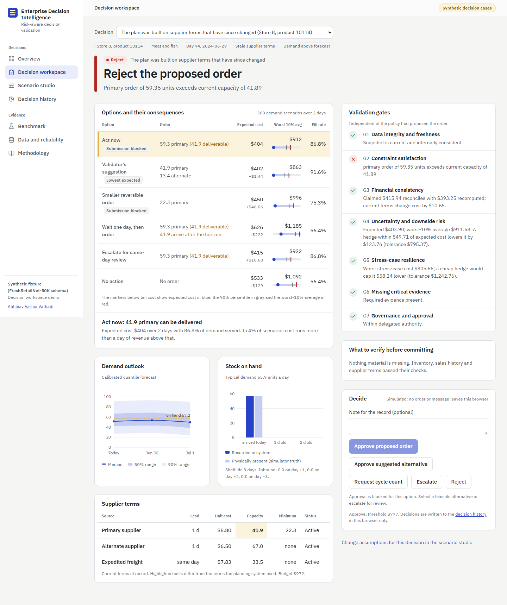
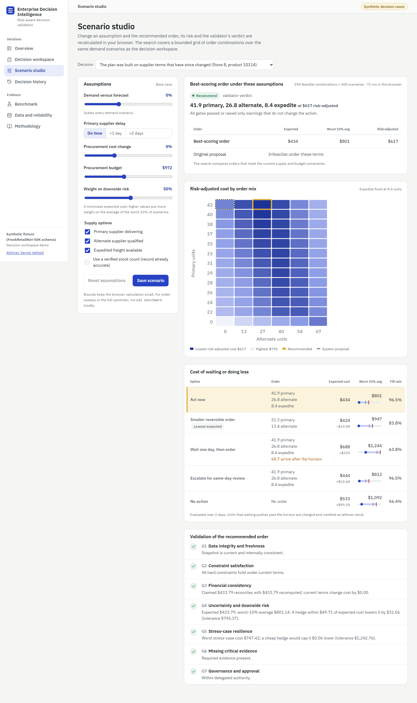
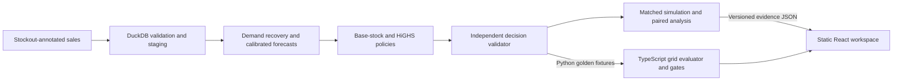

# Enterprise Decision Intelligence

An independent validator for business decisions, with a benchmark that measures what happens when a planner acts, waits, reviews or rejects a proposal.

[Open the live workspace](https://enterprise-decision-intelligence.pages.dev/) · [Explore the benchmark](https://enterprise-decision-intelligence.pages.dev/benchmark)

Fresh-food replenishment makes the trade-off concrete. A forecast drives an order, but spoilage, supplier limits, stale inventory and approval costs determine whether the order should go ahead. The validator checks a standard decision record against current terms and explains its decision across seven gates. The browser workspace lets planners compare actions, change scenario assumptions and record decisions locally.

## Results

| Study | Safety under unreliable data | Total modeled cost with validation |
|---|---|---|
| Controlled synthetic benchmark, 200 store-products | 177 breached submissions fell to zero. Unsafe decisions fell from 4.21% to 0.02%. | **+0.67%** (95% series-clustered interval +0.33% to +0.99%). |
| FreshRetailNet-50K pilot, 60 store-products | 46 breached submissions fell to zero. Unsafe decisions fell from 5.60% to 0.12%. | **−1.19%** (95% series-clustered interval −2.58% to +0.77%). |

The synthetic break-even was **$10.65 in additional assumed cost per breached submission**. In the retail pilot, validation raised modeled cost **3.94% in normal operations**. Selective review reduced governance cost in fresh simulated scenarios, and its unreliable-data total cost interval included zero. The [independent audit](docs/RELEASE_AUDIT.md) reconciles the counts, assesses all five hypotheses and explains how assumptions change the result.

**Evidence provenance.** The retail pilot uses observed, publisher-normalized sales and hourly stockout flags. Demand during genuine stockouts is estimated. Both studies simulate inventory, supplier events, reviews and fulfillment under assumed financial inputs. The browser decision cases and the cloud capacity experiment use synthetic data.

## Application

| Decision workspace | Scenario studio |
|---|---|
|  |  |

[Benchmark on tablet](docs/screenshots/benchmark-tablet.png) · [Benchmark on mobile](docs/screenshots/benchmark-mobile.png) · [All screenshots](docs/screenshots)

## Architecture



Python runs the research pipeline on CPU. The static site uses a feasible, bounded action grid and Python-generated parity fixtures. The production bundle needs no API, model service, account or server-side compute. The cloud experiment shares the decision contract, validator, information-value and statistics routines and supplies its own capacity and SLA cost model.

## Reproduce

Use Python 3.10+ for general development, Python 3.13 with `requirements-lock.txt` for the pinned audit, and Node.js 22+ for the web app.

```bash
python -m pip install -r requirements-lock.txt -e ".[dev,download]"
python scripts/download_freshretailnet.py --revision c374e85975c82816c495acfa904cc55ab14a47d3
python scripts/audit_freshretailnet.py
edi run-all --config configs/research-real.yaml --jobs 4
edi selective-validation --config configs/research-real.yaml --jobs 4
edi export-web --config configs/research-real.yaml
python -m pytest -q

cd apps/web
npm ci
npm test
npm run build
npx playwright install chromium
npm run e2e
```

`configs/ci.yaml` is the small synthetic smoke configuration. Synthetic amendment 2 reproduction uses commit `97acf8b`. The current `configs/research.yaml` runs the amended harness on synthetic data. Run non-release exports in a separate checkout to keep the committed cases and fixtures intact.

## Scope and sources

The retail pilot covers one evaluation week and a 60-series sample. It uses single-item decisions, modeled reviewers and estimated censored demand. Intervals condition on the evaluation week and the experiment's demand, operational and financial assumptions. The local decision history is a browser demonstration.

- [Independent release audit](docs/RELEASE_AUDIT.md) and [controlled synthetic findings](docs/BENCHMARK_FINDINGS.md)
- [Experiment protocol](docs/EXPERIMENT_PROTOCOL.md), [data lineage](docs/DATA_MODEL.md), and [architecture](docs/ARCHITECTURE.md)
- [Deployment](docs/DEPLOYMENT.md), [security](docs/SECURITY.md), and [UI review](docs/UI_REVIEW.md)
- [FreshRetailNet-50K dataset card](https://huggingface.co/datasets/Dingdong-Inc/FreshRetailNet-50K) and [Wang et al.](https://arxiv.org/abs/2505.16319)

FreshRetailNet-50K is published by Dingdong-Inc under [CC BY 4.0](https://creativecommons.org/licenses/by/4.0/). Published pilot artifacts are aggregates. Code is MIT, © 2026 Abhinav Varma Vathadi. See [third-party notices](THIRD_PARTY_NOTICES.md).
