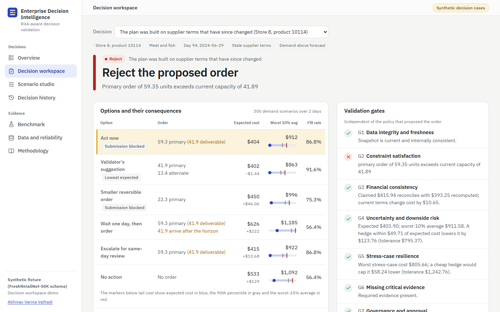
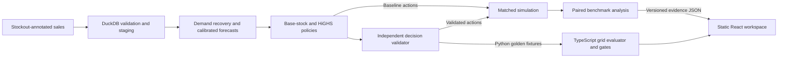

# Enterprise Decision Intelligence

An independent decision validator and reliability benchmark for fresh-food replenishment.

[Open the live workspace](https://enterprise-decision-intelligence.pages.dev/) · [Explore the benchmark](https://enterprise-decision-intelligence.pages.dev/benchmark)

## Business use case

A replenishment planner receives an order based on stale inventory or supplier terms. The order must balance shortages and spoilage while meeting current supplier limits and the purchasing budget. Seven independent gates check the proposal against authoritative data and explain whether to recommend it, investigate, defer, escalate or reject it. The browser workspace compares alternatives, replays changed assumptions and records the planner's decision locally.

## Results

| Study | Safety under unreliable data | Total modeled cost with validation |
|---|---|---|
| Controlled synthetic benchmark, 200 store-products | 177 breached submissions fell to zero. Unsafe decisions fell from 4.21% to 0.02%. | **+0.67%** (95% series-clustered interval +0.33% to +0.99%). |
| FreshRetailNet-50K pilot, 60 store-products | 46 breached submissions fell to zero. Unsafe decisions fell from 5.60% to 0.12%. | **−1.19%** (95% series-clustered interval −2.58% to +0.77%). |

The synthetic break-even was **$10.65 in additional assumed cost per breached submission**. In the retail pilot, validation raised modeled cost **3.94% in normal operations**. Selective review reduced governance cost in fresh simulated scenarios, and its unreliable-data total cost interval included zero. The [independent audit](docs/RELEASE_AUDIT.md) reconciles the counts, assesses all five hypotheses and explains how assumptions change the result.

Both studies use modeled financial inputs. The FreshRetailNet pilot uses observed, publisher-normalized sales and hourly stockout flags, with estimated demand during genuine stockouts. Browser decision cases and the cloud capacity experiment use synthetic data.

## Application



[Full decision workspace](docs/screenshots/workspace-desktop.png) · [Scenario Studio](docs/screenshots/studio-desktop.png) · [Benchmark on mobile](docs/screenshots/benchmark-mobile.png)

## Architecture



Python runs forecasting, optimization and simulation on CPU. The static app uses a bounded action grid with parity tested against Python golden fixtures. The browser runs the evaluator and stores records locally. The cloud experiment reuses the decision contract, validation gates and statistics with its own capacity and SLA cost model.

## Reproduce

Use Python 3.10+ for development and Node.js 22+ for the web app. Activate a virtual environment before installing Python dependencies.

```bash
python -m pip install -e ".[dev]"
python -m pytest -q

cd apps/web
npm ci
npm test
npm run build
npx playwright install chromium
npm run e2e
```

To reproduce the observed-data pilot from the repository root, use Python 3.13 with the pinned audit environment.

```bash
python -m pip install -r requirements-lock.txt -e ".[dev,download]"
python scripts/download_freshretailnet.py --revision c374e85975c82816c495acfa904cc55ab14a47d3
python scripts/audit_freshretailnet.py
edi run-all --config configs/research-real.yaml --jobs 4
edi selective-validation --config configs/research-real.yaml --jobs 4
edi export-web --config configs/research-real.yaml
```

Use `edi run-all --config configs/ci.yaml` in a separate checkout for the small synthetic smoke run, which regenerates local browser fixtures. Commit `97acf8b` reproduces the historical amendment 2 synthetic study.

## Scientific limitations and sources

The pilot covers 60 series and one evaluation week. It models single-item inventory decisions, supplier disruptions and reviewer behavior. Clustered intervals condition on that week and those assumptions. Estimated stockout demand and simulated costs limit conclusions about actual retailer savings. Browser history is a demonstration of local decision records.

- [Independent release audit](docs/RELEASE_AUDIT.md) and [controlled synthetic findings](docs/BENCHMARK_FINDINGS.md)
- [Experiment protocol](docs/EXPERIMENT_PROTOCOL.md), [data lineage](docs/DATA_MODEL.md), and [architecture](docs/ARCHITECTURE.md)
- [Deployment](docs/DEPLOYMENT.md), [security](docs/SECURITY.md), and [UI review](docs/UI_REVIEW.md)
- [FreshRetailNet-50K dataset card](https://huggingface.co/datasets/Dingdong-Inc/FreshRetailNet-50K) and [Wang et al.](https://arxiv.org/abs/2505.16319)

FreshRetailNet-50K is published by Dingdong-Inc under [CC BY 4.0](https://creativecommons.org/licenses/by/4.0/). Published pilot artifacts are aggregates. Code is MIT, © 2026 Abhinav Varma Vathadi. See [third-party notices](THIRD_PARTY_NOTICES.md).
