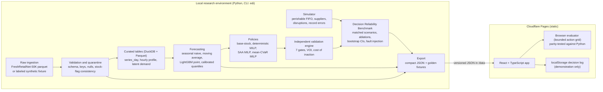

# Architecture

## 1. System overview

The two environments share contracts, not code: the decision candidate JSON Schema (`schemas/decision_candidate.v1.json`), the scenario evaluator semantics (checked by golden fixtures), and the validation gate definitions (checked by gate fixtures).

## 2. Data layers

| Layer | Storage | Contents | Key |
|---|---|---|---|
| raw | `data/raw/<source>/` parquet + `PROVENANCE.json` | Files as downloaded or generated, with checksums | file |
| staged | `data/staged/series_day.parquet` | Typed, standardized rows, `series_id`, `day_index`, `split`, ingestion timestamp | (series_id, dt) |
| quarantine | `data/quarantine/*.parquet` | Rows failing hard checks with a reason code | (series_id, dt, reason) |
| curated | `data/curated/*.parquet`, `data/edi.duckdb` views | hourly profiles, recovered demand, features | (series_id, dt) |
| forecasts | `data/curated/forecasts_<stage>.parquet` | quantiles per (series, origin, horizon) | (series_id, origin_day, h) |
| benchmark | `artifacts/runs/<run_id>/` | raw per-decision results (parquet) + config + manifest | run_id |
| deployable | `artifacts/benchmark/*.json`, `apps/web/public/data/*.json` | small summaries | file |

Event time is `dt` (business date). Ingestion time is recorded per run in the manifest and the staged table. Every stage is idempotent: outputs are written to a temporary path and atomically renamed, and a stage is skipped when its input hash matches the manifest (`--force` re-runs).

## 3. Decision model (primary domain)

Each SKU-store (series) is reviewed daily. Event order on day *d*:

1. Receive arrivals due on *d* (fresh cohort, age 0).
2. Snapshot: recorded on-hand (may differ from true on-hand), pipeline, supplier master snapshot (may be stale), sales history through *d - 1*.
3. Policy proposes orders: expedite (lead 0, arrives before trading on *d*), primary and alternate (lead 1 by default).
4. Validation engine evaluates the candidate against authoritative context and returns an outcome.
5. Executed orders are charged at order time (cash).
6. Demand realizes; sales consume the oldest cohort first.
7. End of day: cohorts reaching shelf life are wasted; holding cost is charged on remaining units.

Costs (all in assumed currency on normalized volumes): procurement, holding, disposal, lost revenue at full unit price, goodwill penalty per unit short, and governance costs (investigation, review). Lost sales are charged at full price rather than margin because the purchase cost of units never bought is already absent from procurement spend; charging margin would understate the shortage cost. The identity `total_cost = price x total_demand - profit` is tested.

## 4. Policies (benchmark)

| ID | Policy | Forecast | Optimization |
|---|---|---|---|
| P1 | Base-stock with tuned safety factor | moving average of observed sales | rule; primary first, alternate if primary capacity is short |
| P2 | Point forecast + deterministic MILP | LightGBM point (observed sales) | single-scenario MILP |
| P3 | Probabilistic + expected cost | stockout-aware calibrated quantiles | SAA MILP |
| P4 | Risk-aware | same as P3 | mean-CVaR SAA MILP (Rockafellar-Uryasev) |
| P5a/P5b | Validation framework wrapping P3/P4 | same as wrapped | wrapped policy + 7 gates + VOI + escalation |
| OR | Oracle (retrospective upper bound) | realized demand and true state | single-scenario MILP |

The validation layer wraps like-for-like policies so its effect is isolated (P5a vs P3, P5b vs P4).

## 5. Validation engine

Inputs: a `DecisionCandidate` and an `AuthoritativeContext` (current supplier master, budget, governance policy, latest stock flags, data timestamps). It never sees the policy's internals.

Gates: G1 data integrity and freshness, G2 constraint satisfaction, G3 financial consistency, G4 uncertainty and downside risk, G5 stress resilience, G6 missing critical evidence, G7 governance and approval. Each gate returns `pass`, `warn` or `fail` with evidence. Outcomes follow a fixed precedence (reject > defer/escalate for stale or missing data > investigate when VOI exceeds its cost > escalate for risk > escalate for approval > recommend). There is no blended reliability score; gate results are shown individually.

## 6. Browser evaluator

The browser evaluates a bounded candidate grid (primary x alternate x expedite quantities, at most 1,000 actions) over precomputed demand scenarios (at most 400 paths, horizon at most 4 days) with the same FIFO step function as Python. It is exact for that grid; it is not the MILP. The UI says so. Requests beyond the bounds show an explanation and the local command to run instead.

## 7. Five-perspective review (before implementation)

Recorded 2026-11-25. Each item lists the concern and the resulting decision.

**Enterprise business stakeholder**
- Concern: currency figures on normalized data could be mistaken for real savings. Decision: every financial figure carries an "assumed economics" label; no ROI claims; README states it plainly.
- Concern: a benchmark that only shows averages hides when a policy fails badly. Decision: report CVaR, worst-decile cost and unsafe-decision rates next to means.
- Concern: escalation is not free. Decision: every investigation and review has a cost in the objective and an unnecessary-escalation metric.

**Data scientist and operations researcher**
- Concern: tuning on the official eval split would invalidate results. Decision: tuning uses decision days 77 to 90; final test uses 91 to 97 (official eval) once, after the protocol is frozen.
- Concern: real stockout periods have no ground truth. Decision: recovery accuracy is measured only on artificially censored in-stock days; benchmark demand during real stockouts uses recovered estimates with lower/upper sensitivity runs.
- Concern: weather and promotions leakage. Decision: weather lagged only; promotions assumed planned one day ahead with an ablation.
- Concern: a 7-day test window is short. Decision: many series, several disruption realizations, cluster bootstrap over series; state the limitation.
- Concern: the brief's oracle could be misread as a target. Decision: oracle reported only as a retrospective bound and used to define regret.

**Data engineer and production architect**
- Concern: the brief suggests dbt; the transformation graph here is small. Decision: plain SQL in DuckDB executed by a Python runner with manifests (ADR-0006). dbt would add a dependency and a second project layout without new capability at this scale.
- Concern: Polars versus pandas. Decision: pandas plus DuckDB. The dataset is 115 MB; DuckDB handles the heavy joins; pandas is ubiquitous. Revisit only if profiling shows a bottleneck.
- Concern: no orchestration framework. Decision: a CLI with idempotent stages and a run manifest is enough and testable.

**Security, governance and reliability reviewer**
- Concern: importing external decision JSON in the browser is an input-validation surface. Decision: 1 MB limit, schema validation with zod, no HTML rendering of imported strings, strict CSP in `_headers`.
- Concern: browser-local "audit" records. Decision: hash-chained entries detect accidental edits; UI and docs say they are not tamper-proof and not a system of record.
- Concern: hard failures masked by weighted scores. Decision: no composite score.

**Technical hiring manager and product designer**
- Concern: a wall of KPI cards reads as generic. Decision: the core screen is a decision dossier with an action comparison table, a cost distribution chart and a gate ledger.
- Concern: research claims without visible evidence. Decision: the benchmark page shows intervals, ablations and negative findings, with links to the raw JSON.
- Concern: scope creep across many industries. Decision: one complete primary domain, one secondary domain (cloud capacity), with a written list of what is domain-specific.

## 8. Deviations from the brief

See `docs/decisions/`. Summary: no dbt (ADR-0006); synthetic fixture first because the dataset host was blocked (ADR-0002); Stockpyl used as a comparator, not a dependency (ADR-0004); no LLM adapter (ADR-0008).
